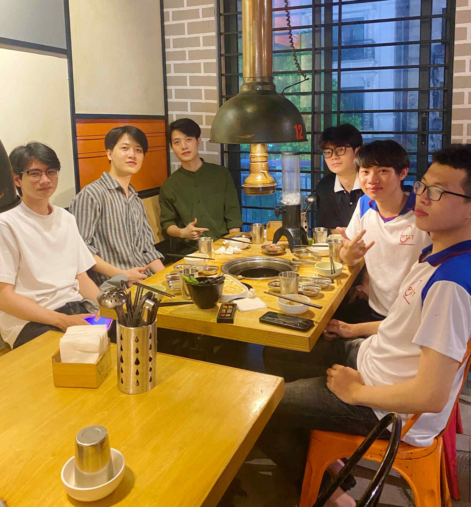

<h1 align="center">👋 Hi, I'm Nguyễn Hữu Hùng </h1>

<p align="center">
  🎓 PTIT 2023–2028 | Computer Electronics Engineering<br>
  🏡 Ha Dong, Hanoi, Vietnam<br>
  ❤️ Web Frontend & Embedded Software<br>
  💥 Learning Node.js Fullstack
</p>

<p align="center">
  
</p>

<p align="center">
  <i>Learning and growing together at PTIT 🚀</i>
</p>

---

## 📜 Certificates

- 💥 TOEIC 570 (03/2026)
- 💻 F8 Frontend Web Development Certificate (11/2026)
- 💻 F8 Fullstack Node.js Web Development Certificate (02/2027)

---

## 🛠️ Tech Stack (02/2027)

### 🔹 Languages


### 🔹 Web


### 🔹 Backend


### 🔹 Frontend


### 🔹 Database


### 🔹 Others


---

## 🗺️ Fullstack Node.js Learning Roadmap

```text
                  FULLSTACK NODE.JS
                         │
            ┌────────────┴────────────┐
            │                         │
        FRONTEND                  BACKEND
            │                         │
       HTML / CSS                  Node.js
       JavaScript                 Express.js
       TypeScript                 REST API
       React                      Authentication
       Next.js                    Authorization
            │                         │
            └────────────┬────────────┘
                         │
                      DATABASE
                         │
                   MongoDB / MySQL
                         │
                  DEVELOPMENT TOOLS
                         │
                    Git / GitHub
```

---

<p align="center">
  <i>Building projects, learning every day, and moving forward 🚀</i>
</p>
